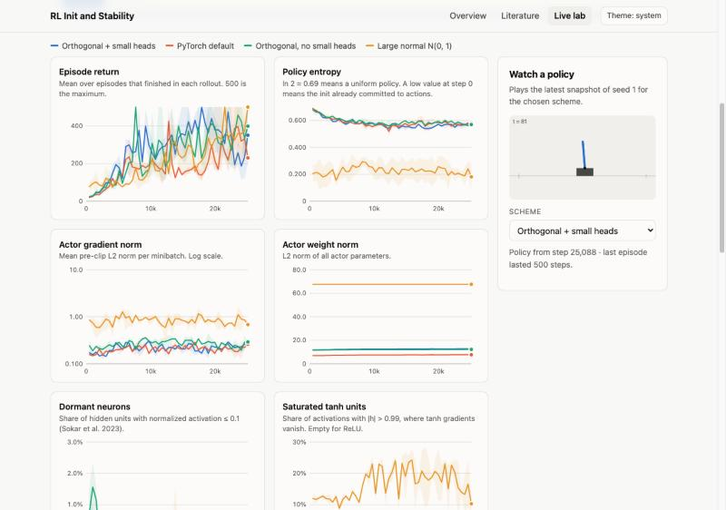
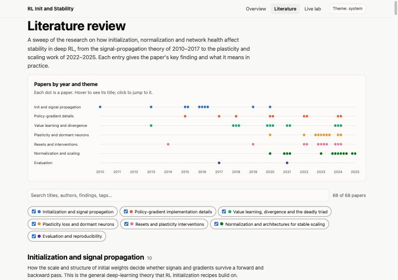
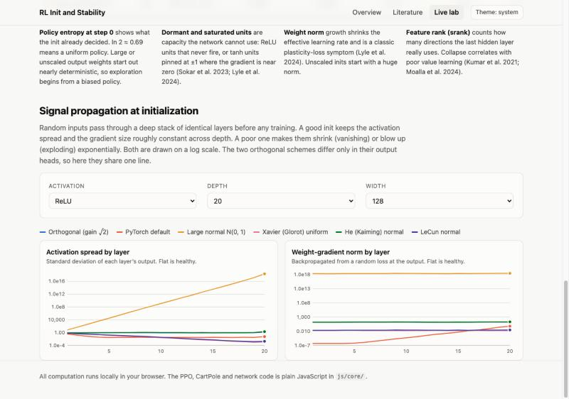

# RL Init and Stability

A website with a literature review of 68 papers on how weight initialization and network health shape training stability in deep reinforcement learning, plus a live lab that trains PPO agents in your browser to show it.

## Links

- [Instructions](docs/INSTRUCTIONS.md): run it (`npm start`), use it, test it (`npm test`)
- [Literature review](docs/LITERATURE.md): the full review, readable on GitHub
- [System design](docs/SYSTEM-DESIGN.md): architecture, flows, decisions, known limits
- [File structure](docs/FILE-STRUCTURE.md): what's where
