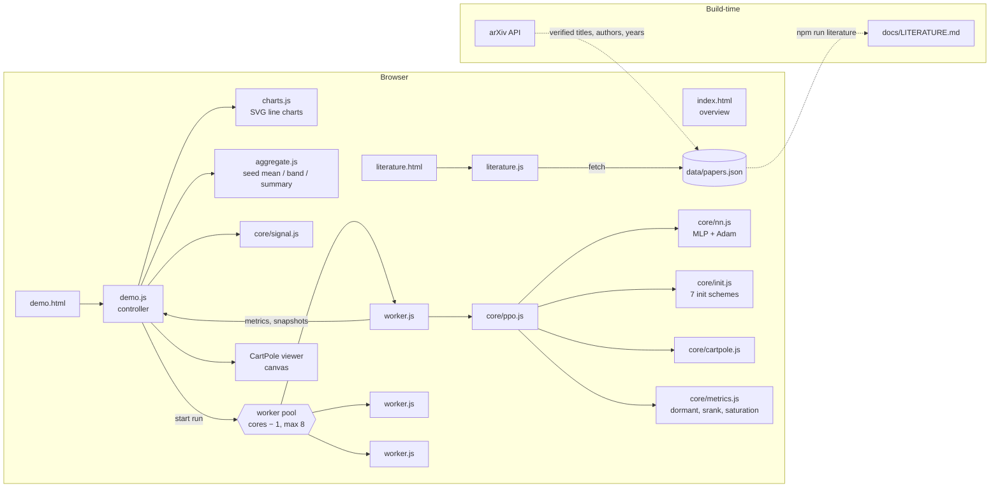

# System Design

RL Init and Stability is a static website with three pages: an overview, a literature review and a live lab.
There is no server-side code and no build step. Every page is plain HTML, CSS and ES modules, served by any static file server.

## Architecture

## Components

| Component | Job |
|---|---|
| `site/index.html` | Overview: what the project is, seven synthesized findings that link to papers, and an honest note on what the demo can show. |
| `site/literature.html` + `js/literature.js` | Loads `papers.json` and renders a year-by-theme dot timeline, a search box, theme filters and paper cards grouped by theme. Following a deep link (`#2302.12902`) clears filters if needed and scrolls to the paper. |
| `site/data/papers.json` | Single source of truth for the review: 7 themes and 68 papers. Each paper has a title, authors, year, venue, URL, tags, a key finding and why it matters. |
| `site/demo.html` + `js/demo.js` | Lab controller. Reads the settings, queues one job per (scheme, seed), runs them in a Web Worker pool, aggregates metrics and renders 8 charts, a summary table and the CartPole viewer. Also drives the signal-propagation explorer. |
| `js/worker.js` | Runs one PPO training run to completion and posts a metrics record after every update, plus an actor snapshot every third update. |
| `js/core/ppo.js` | PPO with a clipped surrogate objective, GAE(λ), separate actor and critic MLPs, advantage normalization, global-norm gradient clipping and correct bootstrapping at time-limit truncation. `update()` collects a rollout, measures network health on it, then optimizes. |
| `js/core/nn.js` | Dense MLP with tanh or ReLU, hand-written backprop (checked against finite differences), Adam with ε = 1e-5, and serialization. |
| `js/core/init.js` | Seven init schemes (PyTorch default, Xavier, He, LeCun, orthogonal with small heads, orthogonal without, N(0,1)). The last layer takes a role (`policy`, `value` or `hidden`) so a scheme can treat heads differently. |
| `js/core/cartpole.js` | CartPole-v1 dynamics ported from Gym. Tests match a recorded Gym trajectory to 1e-6. |
| `js/core/metrics.js` | Dormant-neuron fraction (Sokar et al. 2023), tanh saturation, and srank (Kumar et al. 2021) via Jacobi eigenvalues of the feature Gram matrix. |
| `js/core/signal.js` | Pushes Gaussian inputs through a deep untrained MLP and returns per-layer activation std and weight-gradient norm. |
| `js/charts.js` | Small SVG line-chart component: mean line, min–max band, end dot, log-y option and a crosshair tooltip. Colors are CSS variables, so the theme switch needs no re-render. |
| `js/aggregate.js` | Pure functions: per-update mean, min and max across seeds, and summary rows (final return, steps to 475, start and final health metrics). |
| `js/site.js` | Light / dark / system theme toggle, remembered in `localStorage` when available. |

## Main flows

**Training a comparison.**
The user picks schemes and settings and presses Train.
`demo.js` builds one job per scheme and seed, interleaved by seed so every scheme draws a curve early, and starts up to `hardwareConcurrency − 1` workers (at most 8).
Each worker builds a `PPO` from the config and loops `update()` until it reaches the step budget.
Each update sends one metrics record.
The controller appends it to that run's history and re-renders at most every 200 ms.
When a worker finishes, it is terminated and the next job starts.
Stop terminates every worker; partial histories stay on screen.

**Watching a policy.**
Snapshots from seed 1 of the selected scheme go to the viewer.
The viewer samples actions from the snapshot policy on its own CartPole instance at real time (50 steps per second), and swaps in newer snapshots between episodes.

**Signal propagation.**
Changing activation, depth or width recomputes all schemes on the main thread (under 1 s) and redraws the two log-scale charts.

**Literature.**
`literature.js` fetches `papers.json` once.
Search and theme filters re-render the list client-side; search is an AND over words, across title, authors, finding, lesson, tags, venue and year.

## Where data lives

- **Paper data:** `site/data/papers.json`, committed. `docs/LITERATURE.md` is generated from it.
- **Training results:** in memory in the page only. Nothing is persisted or sent anywhere.
- **Theme preference:** `localStorage['theme']`, wrapped in try/catch. The page works without it.

## Key decisions and trade-offs

| Decision | Why | Cost |
|---|---|---|
| Website only, no Mac app | The deliverable is a website, and the user chose "website only" when asked. | No offline desktop packaging. |
| Plain JS RL instead of TensorFlow.js or ONNX | Zero dependencies, readable source, identical code in Node tests and the browser, full control over the health metrics. | About 100–250 MFLOP/s, so networks and budgets have to stay small. |
| CartPole + PPO | Classic, fast, well understood, and every init can solve it, so differences show up in learning speed and health metrics. | Too easy to show catastrophic init failures in return. The site says so plainly. |
| Cheaper PPO defaults (512-step rollouts, 4 epochs, minibatch 128, lr 1e-3, 50k steps) | Keeps a default comparison to about a minute. The first prototype (10 epochs, 100k steps) took about 150 s per run. | Departs from the CleanRL CartPole defaults; documented in the UI and here. |
| One Web Worker per run; the worker never yields | Uses all cores and keeps the UI smooth. Yielding with `setTimeout` or `MessageChannel` was throttled to seconds per tick in background tabs. Stop uses `terminate()`. | A run can't be paused, only stopped. |
| Mean line with a min–max band over seeds | Follows Henderson et al. and Agarwal et al.: never trust one seed. With 2–5 seeds a range is more honest than a confidence interval. | The range widens as seeds are added. |
| Fixed color per scheme (`SCHEME_IDS` order) | Color follows the entity, so deselecting a scheme never repaints the others. The palette is validated for color-vision deficiency in light and dark. | A seven-color limit. |
| Paper metadata pulled from the arXiv API | Titles, authors and years are verified rather than written from memory. | Non-arXiv sources (Glorot 2010, the PPO blog post) were entered by hand. |

## Testing

`npm test` runs Node's built-in test runner over `tests/*.test.mjs` (about 15 s):

- **`core.test.mjs`**:
  - RNG determinism and moments.
  - Backprop against finite differences (tanh and ReLU).
  - Adam fitting a regression.
  - Orthogonality of the orthogonal init (square, tall and wide).
  - Weight variances for every scheme.
  - Small-head init giving a near-uniform policy.
  - CartPole against a recorded Gym trajectory, and truncation at 500 steps.
  - Jacobi eigenvalues, srank on a rank-3 matrix, and dormant and saturated fractions.
  - Signal propagation: He preserves ReLU signals, PyTorch default shrinks toward its bias floor, N(0,1) explodes.
- **`ppo.test.mjs`**:
  - Determinism per seed.
  - All metrics finite on the first update, with a uniform starting policy under small-head init.
  - PPO learns CartPole within 15k steps.
  - The aggregation and summary helpers.
- **`site.test.mjs`**:
  - `papers.json` schema and unique IDs.
  - Every `literature.html#id` link on the pages resolves.
  - The overview's paper and theme counts match the data.
  - Every referenced asset exists.
  - Search semantics.

Browser behavior (workers, charts, viewer, theme) was checked by hand in the desktop app's browser pane.

## Known limits

- CartPole is easy. With a shallow network most inits reach 500, so init shows up mostly in health metrics and early learning speed rather than final return.
- Training speed depends on the machine: about 0.25 s per PPO update on a modern laptop core, and much slower under heavy load.
- One environment per run, no observation normalization and no learning-rate annealing. This is a teaching implementation, not a benchmark one.
- Health metrics are computed on the first 256 states of each rollout, for the actor only.
- `file://` does not work, because ES modules and workers need HTTP. Use `npm start`: a dependency-free Node server (`scripts/serve.mjs`) that falls back to the next free port and sends `no-cache` headers so edited modules are never served stale.
- The literature sweep covers work up to mid-2025 and is curated, not exhaustive.
